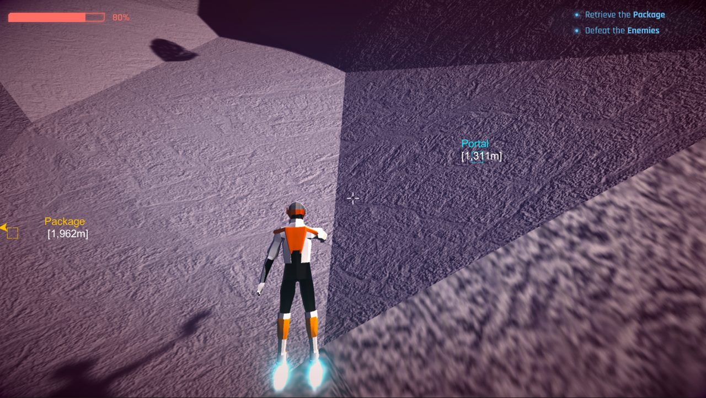
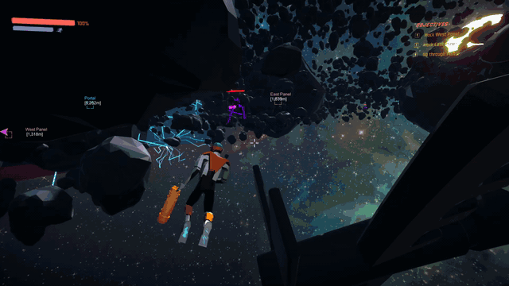
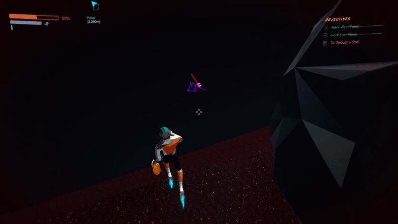
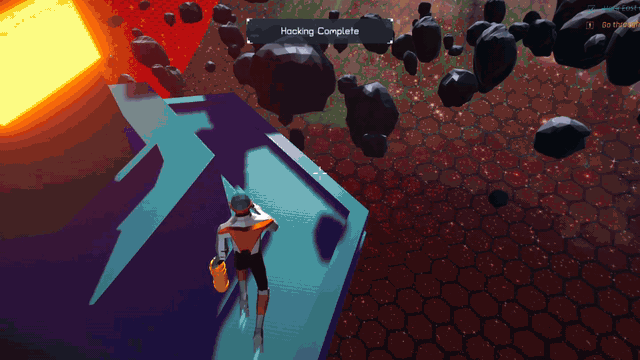
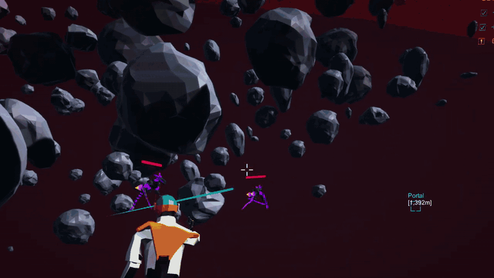
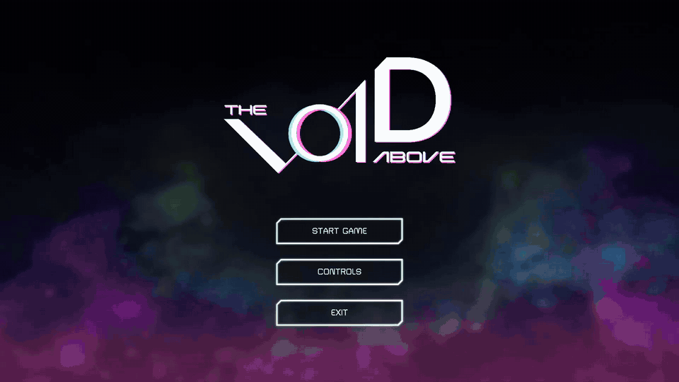
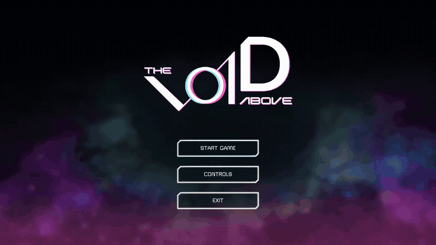
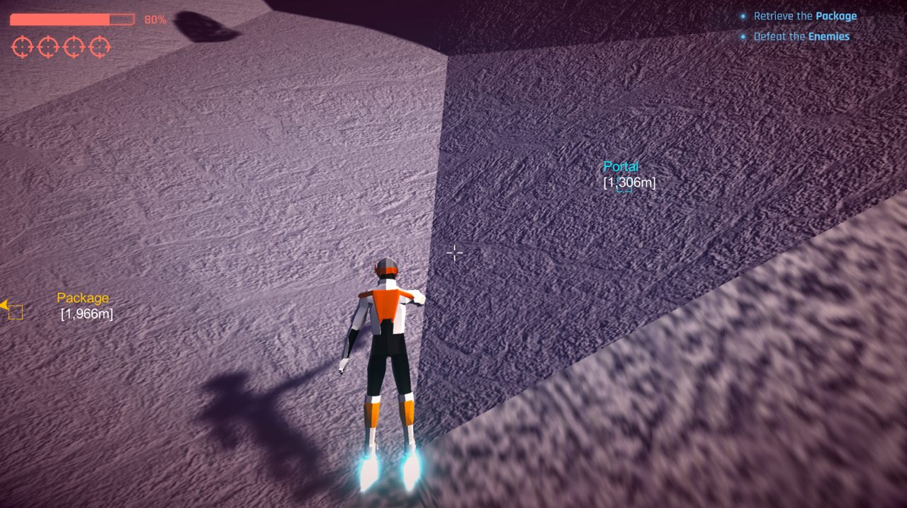
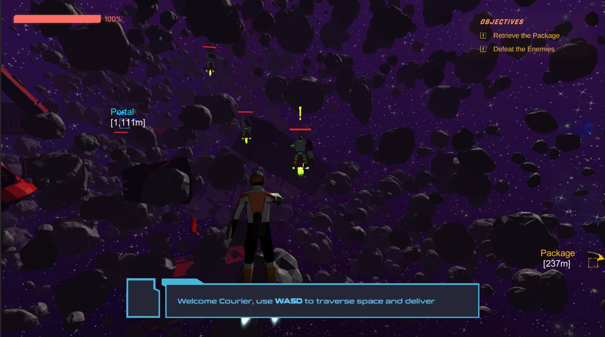

# The Void Above

A 3D sci-fi action-adventure built in **Unity** by **Void Gaming**, a 10-person
student studio at **Drexel University** (GMAP 378, 2020–2021).

You play a courier who must deliver a package through deep space during an
intergalactic conflict, flying through debris with thrusters and dashes while
enemy forces try to take the package from you.
Inspired by *Journey* and *Death Stranding*.

**▶ Download (Windows):** [itch.io](https://ahnafnafee.itch.io/thevoidabove) ·
**Full team project:** [ahnafnafee/TheVoidAbove](https://github.com/ahnafnafee/TheVoidAbove)

**Team & pipeline:** 10 developers · Unity 3D · Perforce (version control) · Wwise (audio)

---

## My Role

I was one of the team's programmers, working on gameplay AI, the cutscene and UI:

- **Enemy AI**: wrote the melee enemy state machine, and added patrol and
  leash/return behavior to all enemies, including the ranged enemy
- **Opening cutscene**: built the comic-style intro sequence with page
  transitions, a skip button and async loading into the first level
- **UI**: designed and built the Key Bindings screen (using the Hexart UI kit),
  plus the ammo HUD and the player's ammo count logic
- **Enemy feedback**: added the "!" aggro marker shown when an enemy spots the player

## Design Notes

**Why enemies return home (leash behavior)**
During playtesting I noticed that once the player triggered an enemy, it would
follow them across the whole map unless they killed it. I added a leash: if an
enemy is pulled too far from its patrol area, it gives up the chase, returns to
its spawn point and resumes patrolling. Fights stay local, and players can
choose to disengage instead of being forced to fight everything they wake up.

**Why a "!" appears above enemies**
Players need to know the moment they've been spotted. As a longtime player
myself, I've seen this convention in many games, and it works because players
read it instantly. The "!" gives a clear, readable signal before the enemy
attacks, so damage never feels unfair.

**Why the cutscene uses two-step clicks**
Players read at different speeds. Some like watching captions type out; others
want the full text right away. The first click completes the current caption,
and the second moves to the next panel, so both styles are supported. For
returning players who've already seen the story, a Skip button jumps straight
to gameplay.

## Enemy AI

**Spot & attack:** patrolling enemy sees the player, shows "!", charges and attacks

 

**Leash & return:** pulled out of its area, the enemy shows a green return marker and flies back to its post

 

Each melee enemy runs a small state machine:

| State | Behavior |
|---|---|
| **Patrol** | Wanders around its spawn point, picking a new direction every few seconds |
| **Chase** | When the player enters its detection range or shoots it, an `!` marker appears and it dashes toward the player |
| **Attack** | In melee range it turns to face the player, winds up, and strikes (with Wwise sound and damage) |
| **Return** | If pulled too far from its spawn area it shows a return marker, waits, then flies back and resets to Patrol |

The leash/return behavior keeps enemies from being dragged across the whole map
and lets players disengage from a fight.

Code: [`MeleeEnemyControl.cs`](Scripts/EnemyAI/MeleeEnemyControl.cs) · [`MarkControl.cs`](Scripts/EnemyAI/MarkControl.cs)
(originals in the team repo: [MeleeEnemyControl](https://github.com/ahnafnafee/TheVoidAbove/blob/main/Assets/_Project/Scripts/Enemy/MeleeEnemyControl.cs), [MarkControl](https://github.com/ahnafnafee/TheVoidAbove/blob/main/Assets/_Project/Scripts/MarkControl.cs))

## Opening Cutscene

A comic-book style intro told across several pages. Panels and captions appear
one at a time. Clicking finishes the current caption or moves to the next panel.
Finished pages fade out before the next one starts. At the end, or on **Skip**,
the first level loads with a progress bar.

Code: [`FlowControl.cs`](Scripts/Cutscene/FlowControl.cs) ([original](https://github.com/ahnafnafee/TheVoidAbove/blob/main/Assets/_Project/Scripts/CutScene/FlowControl.cs))

## UI

- **Key Bindings screen**: shows keyboard and mouse controls (move, up/down,
  decelerate, shoot, dash)
- **Ammo HUD**: 5-slot ammo display that updates on firing and reloading
  ([`AmmoControlUI.cs`](Scripts/UI/AmmoControlUI.cs), [original](https://github.com/ahnafnafee/TheVoidAbove/blob/main/Assets/_Project/Scripts/UI/AmmoControlUI.cs))

## Screenshots

 

## What I'd Do Differently

**Playtest movement feel early, with outsiders.**
Replaying the game five years later, the movement felt hard to control: too much
inertia to stop or turn cleanly, and vertical movement on Space/Shift felt awkward.
As a team we focused on adding features and mostly tested among ourselves, so we
got used to the controls instead of fixing them. Today I would bring in outside
playtesters from the first prototype and treat movement feel as a top priority,
since in a flying game it's what players experience every second.

**Write AI code that scales.**
Looking back at my enemy AI, I'd make three changes:
- Cache the player reference instead of calling `GameObject.Find("Player")` every frame
- Use an `enum` for AI states instead of magic numbers (0–3)
- Expose tuning values (speed, ranges, timings) in the Inspector so designers can
  adjust them without touching code

## Tech

Unity (C#) · Cinemachine · Wwise · Perforce · Windows

## Team

Void Gaming: Peng, John, Ivan, Aman, David, Dylan, Ahnaf, Dawei, Jay, Robert

## About This Repository

This repo highlights **my part** of the project. The scripts in `Scripts/` are
copies of the code I wrote, taken from the team's repository. The team used
Perforce during development, and a teammate later mirrored the project to GitHub,
so the commit history there doesn't show individual authors.
